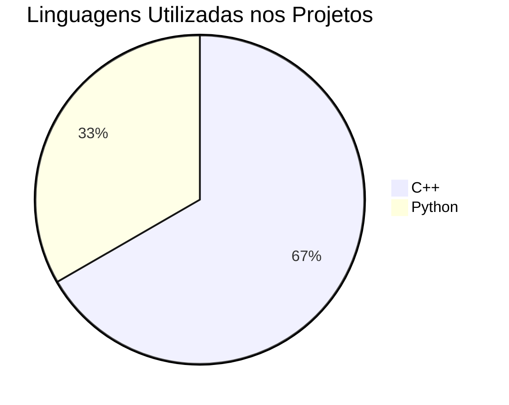

<table align="center" border="1" cellpadding="5" cellspacing="0" style="border-collapse: collapse; border: 1px solid black;">
  <tr>
    <td style="border: 1px solid black; padding: 5px;">
      <p style="text-align: center;">Bem-vindos à Organização</p>
      <p style="text-align: center;"><a href="https://github.com/ifsc-sj-tec-assistiva/" target="_blank">&nbsp;&nbsp;&nbsp;&nbsp;&nbsp;&nbsp;&nbsp;&nbsp;&nbsp;IFSC-SJ-Tec-Assistiva&nbsp;&nbsp;&nbsp;&nbsp;&nbsp;&nbsp;&nbsp;&nbsp;&nbsp;</a></p>
    </td>
  </tr>
</table>

---

#### IFSC - Campus São José - Pesquisa em Tecnologia Assistiva

<div align="center">

[](#)
[](#)
[](#)
[](#)
[](#)
[](#)

[Website IFSC](https://www.ifsc.edu.br/web/campus-sao-jose) | [GitHub Organization](https://github.com/ifsc-sj-tec-assistiva)

</div>

---

#### 📚 Sobre a Organização

Esta organização reúne projetos de pesquisa, desenvolvimento e inovação em **Tecnologia Assistiva** conduzidos pelo **Grupo de Pesquisa da Área de Telecomunicações** do [Instituto Federal de Santa Catarina - Campus São José](https://www.ifsc.edu.br/web/campus-sao-jose). O grupo desenvolve soluções abertas de hardware e software — integrando sistemas embarcados, conectividade sem fio (BLE), sensoriamento e visão computacional — com foco em acessibilidade, autonomia e inclusão.

---

#### 🛠️ Linhas de Atuação e Tecnologias

| Linha de Pesquisa | Tecnologias / Hardware | Linguagem | Repositório Base | Objetivo |
| :--- | :--- | :--- | :--- | :--- |
| Dispositivos Embarcados e Acionadores Sem Fio | ESP32, Sensores de Pressão e Inerciais, BLE HID | C++ | [GitHub Organization](https://github.com/ifsc-sj-tec-assistiva) | Desenvolvimento de mouses adaptados e acionadores sem fio de baixo custo |
| Interfaces Homem-Máquina (IHM) | Microcontroladores, Sensores de Movimento, USB/BLE | C++ | [GitHub Organization](https://github.com/ifsc-sj-tec-assistiva) | Rastreamento de movimento de cabeça e interfaces alternativas de controle |
| Visão Computacional Assistiva | Processamento de Imagem, Aprendizado de Máquina | Python | [GitHub Organization](https://github.com/ifsc-sj-tec-assistiva) | Interação sem contato e tecnologias assistivas baseadas em câmera |

---

#### 🗄️ Índice de Projetos de Tecnologia Assistiva

| Data | Área | Linguagem | Projeto (Repositório) | Descrição / Aplicação | Licença | Visibilidade |
| :--- | :--- | :--- | :--- | :--- | :--- | :--- |
| 2026 | Telecomunicações | Python | [assistive-computer-vision](https://github.com/ifsc-sj-tec-assistiva/assistive-computer-vision) | Soluções de visão computacional voltadas para acessibilidade e interação assistiva | - | Público |
| 2026 | Telecomunicações | C++ | [HeadMouseIFSC](https://github.com/ifsc-sj-tec-assistiva/HeadMouseIFSC) | Dispositivo de controle de cursor por movimento de cabeça focado em acessibilidade | - | Público |
| 2026 | Telecomunicações | C++ | [botao-bola-ble](https://github.com/ifsc-sj-tec-assistiva/botao-bola-ble) | Acionador BLE Mouse HID utilizando ESP32-C3 Super Mini e sensor de pressão HX710B | GPL-3.0 | Público |

---

#### 🖥️ Distribuição de Linguagens



---

*Última atualização: Novembro de 2026*

#### 🧰 Equipe Mantenedora

```text
Grupo de Pesquisa - Área de Telecomunicações
Instituto Federal de Santa Catarina (IFSC) - Campus São José

Pesquisadores Mantenedores:
• Prof. Ramon Mayor Martins ([https://rmayormartins.github.io/](https://rmayormartins.github.io/))
• Prof. Diego da Silva de Medeiros
• Profa. Deise Monquelate Arndt
• Prof. Fabio Alexandre Souza
• Profa. Claudia Teles
```

---

#### 📝 Licença

Os projetos desta organização utilizam licenças de código aberto (como **GNU GPL v3.0** e **MIT**) visando a livre replicação e o impacto social. Consulte o arquivo `LICENSE` em cada repositório individual para mais detalhes.

---

<div align="center">
  
#### IFSC - Campus São José - Tecnologia Assistiva

</div>
